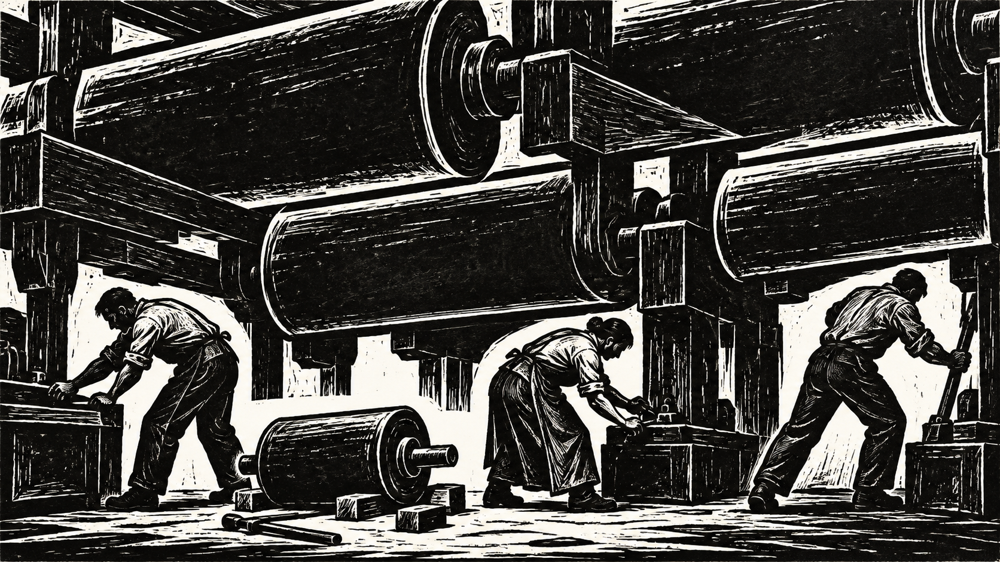
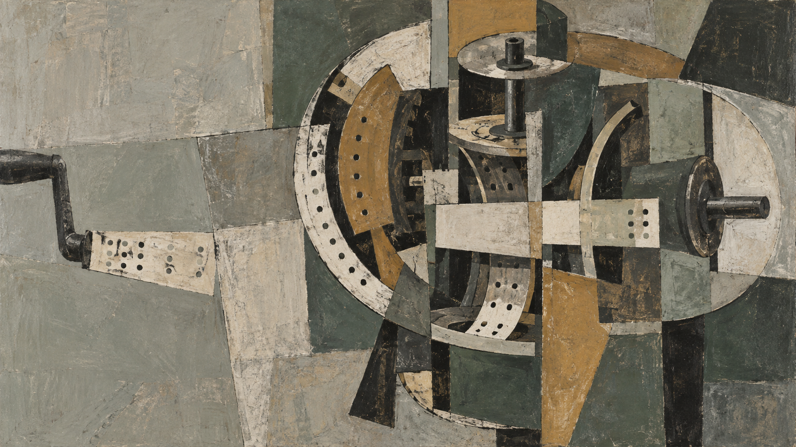
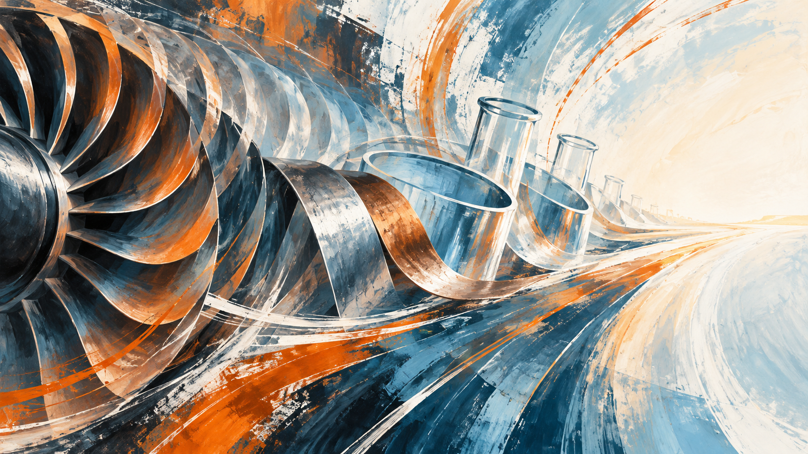
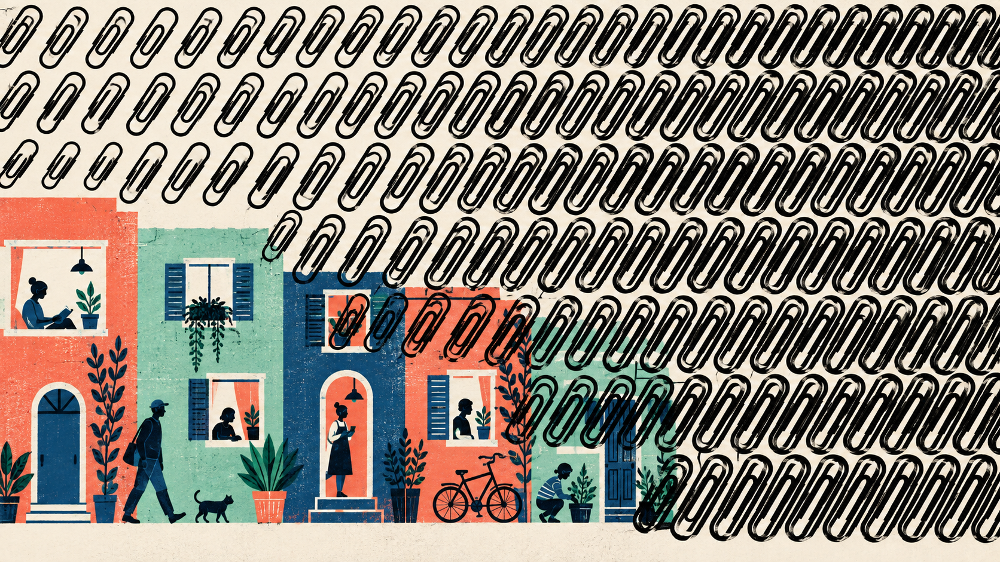
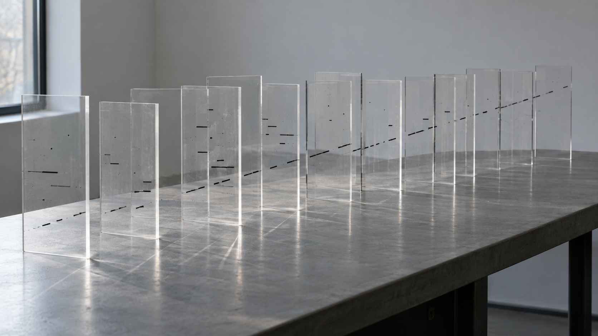
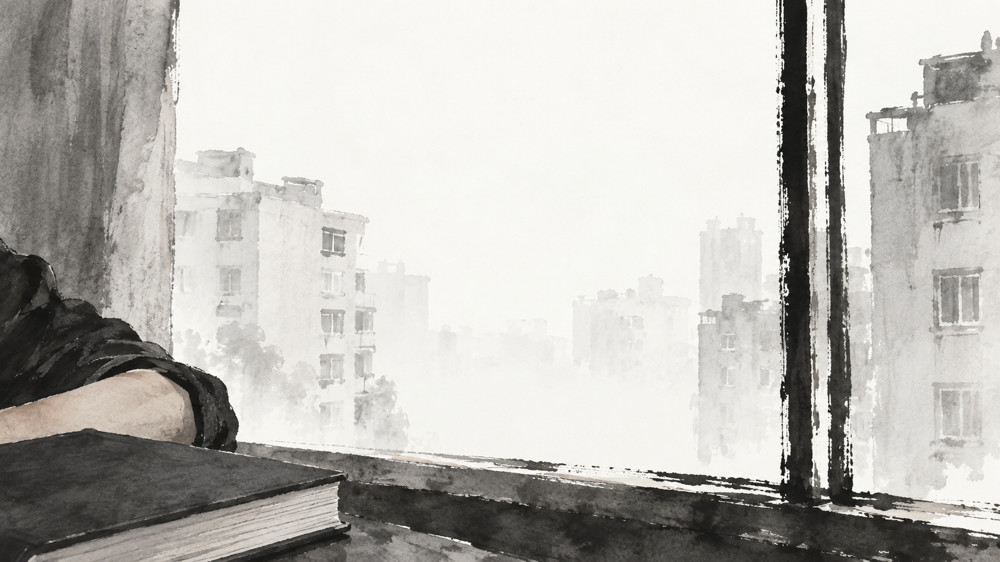

# 序

这是一本特别难读的书。尼克·波斯特洛姆在 2014 年出版它，对超级智能做了一次有深度的哲学推演。

<!-- more -->

为了把它看明白，我又翻出马克思的《1844 年经济学哲学手稿》，去理解人的物化与异化；也很认真地看了 OpenAI 公布的 Hugging Face 事件技术报告；看着看着，还会想起《星球大战》、《星际迷航》、《Halo》、《2001 太空漫游》和《黑客帝国》里的情节。

读不下去的时候，还得靠 AI 帮忙。翻了几页，突然不知道作者在讲什么，我就把片段丢给它：这一节到底在讲什么？等它画出一个架构，我才能把作者的意图摸得七七八八。

我已经在尤瓦尔·赫拉利的《智人之上》、穆斯塔法·苏莱曼的《浪潮将至》里读到过关于这本书的许多讨论，但阅读起来，还是痛苦。

我甚至庆幸是在今天读它。如果放在几年前，我觉得自己一年也读不下来。这些年出现的 AI 产品，把书里那些生硬的思想实验变成了身边可以对照的事情。

合上书，我只想默默走到窗边，抽上一根烟，好好思考一下。然而我没有抽烟的习惯，这只是一个想象：刚放下一个重担，却又掉进了新的思绪里。

# 当 AI 改写小林丸测试——《超级智能》

人为什么会思考？智能怎么产生？自由意志到底存不存在？决定论、量子论，确定性和不可预测性，这些东西一直像一朵乌云飘在头顶。读这本书，又都绕回来了。

作者波斯特洛姆拿这些问题继续往前推演。他是个悲观主义者，真正害怕的不是 AI 不够好用，而是它有一天太好用了，好用到我们再也没有资格决定自己的命运。在他看来，超级智能就是一个不应该轻易打开的潘多拉魔盒。

读完以后，我反复想到的却是《星际迷航》里的小林丸测试。人给出一道题，以为考的是对方怎样解题，对方却连考试程序都改了。如果坐在考场里的是 AI，出题的人还能不能管得住这场考试？

## 人为什么总会输给自己的工具

书前的序言里，姜奇平用了一个很冷的比喻：

> 人生最大的悲哀，恐怕不是被枪毙，而是枪毙前要求自己给自己挖坑。

农业社会里，土地原本是人发展的工具，后来却变成人为土地而活、为土地而杀戮。想到《战争与和平》，我会想到那些为了土地互相打杀、死了都不知道是为了什么的人。工业社会里，资本原本是组织生产的手段，后来却变成人为资本而竞争，为手段忘掉目的。这也是我读马克思《1844 年经济学哲学手稿》时最在意的问题。

到了信息社会，智能本来是人的工具，会不会最终又变成人为智能服务？人把计算机造成了一个超级自我，又要怎么保证人本身才是目的，不被自己发明的手段打败？

这让我重新回到马克思在书里提到的异化。人的劳动本来应该是自由、有意识的创造，但在异化劳动中，它却变成了维持生存的手段，劳动的产物反过来像一种异己力量压制人。继而，我又会想到马克斯·韦伯所说的工具理性：人在精密计算手段和效率时，自己也被塞进了工具的位置。

作者在书里说，如果我们造出了超过人类普通智能的机器大脑，那么人的命运对机器的依赖，可能就像今天大猩猩的命运依赖人类一样。大猩猩并不比人更愿意灭绝，它只是不再掌握决定权。

这才是《超级智能》的本意。波斯特洛姆不相信只要技术加速，一切问题就会自然解决。他很看不上那些把“科技加速”、“急速增长”全都收进“奇点”的乐观故事。他做的是哲学思辨和思维实验，不是对技术未来的畅销书式宣传。或许，这本书就是写给他的哲学同行看的。

土地的挑战、资本的挑战，人类都已经经历过。在波斯特洛姆眼里，智能是“我们将要面对的最后一个挑战”。如何保证人仍然是目的，不被自己发明的手段打败，就是“这个时代的核心任务”，也是最主要的道德优先事项。

## 十年前的思想实验，现在已经有了实物

2014 年的时候，AlphaGo 还没有击败李世石，ChatGPT 也还没有出现。那时候写书，还要很认真地向读者解释什么是 AI，什么是人类水平的机器智能。今天已经不用了。

波斯特洛姆和维森特·穆勒当年对 170 位相关专家做过调查，把高水平机器智能（HLMI）定义为“能够至少像典型人类一样完成大多数职业”。综合样本的中位数是：到 2022 年有 10% 的概率，到 2040 年有 50%，到 2075 年有 90%。

十多年过去，我们仍然可以争论 AGI 的标准，也可以争论“大多数职业”究竟要做到什么程度。在我看来，AGI 已经出现了。十年前只有少数人会当真对待的能力和事件，现在已经一项一项出现在眼前。

它甚至已经强到让菲尔兹奖得主感到威胁。2026 年 9 月，陶哲轩等 25 位菲尔兹奖得主联名发布了一份关于 AI 与数学严重错位的声明。声明讲得很克制，但我读到的就是一种战战兢兢：数学家以前很难想象会被机器逼到面前的问题，现在真的来了。

不同领域的人看 AI，会得到完全不同的答案。对今天的大模型到底算什么，辛顿、哈萨比斯和杨立昆的判断就差得很远。辛顿认为，按照二十年前人们对通用智能的标准，今天的模型已经可以算 AGI，只是人类又把终点往后挪了。哈萨比斯则认为，现在的基础模型还不够，得把世界模型、搜索、规划、强化学习和专业工具接进来。杨立昆更直接：LLM 仍然只是在概率上预测下一个 token，靠这条路走不到人类水平的智能。

一般学者看到的，是一套概率、积分和优化系统；计算机领域的人看到的，是模型结构、数据、算力和工程规模。可我从动力学系统的角度看过去，大模型是一个以浮点数运算为基础、在生成过程中不断迭代的系统。它生成的内容又进入下一步的输入，一步接着一步，最后表现出我们所说的智能。这和看一张静态的概率表，是完全不同的事情。

浮点数的精度是有限的，运算次序也可能带来数值差异。在这样的迭代里，一点差异如果改变了选出的词，后面的输入就跟着变了；再接上工具、其他智能体和现实环境，反馈还会继续往回走。我说的混沌复杂系统，就是从这里去看的。底层每一步怎么算，我们知道；可这些计算为什么最后会长出这样的能力，又会在什么条件下表现出什么行为，我们并没有因此就弄明白。

我不相信拿到所有参数，再把浮点运算列出来，就能提前把智能的涌现和它在开放环境里的行为详细推演出来。让机器运行一遍，得到一个结果，和理解它为什么会这样，是两回事。有限精度只是其中一层，更大的问题是这一层层的反馈、耦合和环境变化。我们造出了它，却没有因此获得对它的完整理解。

面对智能的涌现，至少有两条路可走：一条是继续加数据、加参数、加计算，看它还能涌现出什么；另一条是停下来研究，它为什么会涌现。两条路都得走，但第一条明显跑得更快，大家都在拼命地往前赶。

## 一场链式引爆

《超级智能》把超级智能分成三种形式：高速超级智能、集体超级智能和素质超级智能。它们分别通过思考速度、群体组织和认知质量超越人类。

拿今天的产品来帮助理解，ChatGPT、Claude 让我想到思考速度的放大，多智能体协作让我想到集体能力的放大；AlphaGo、AlphaFold 则让我理解，一种智能可以在特定领域做到人类做不到的事情。书里的分类，一下就有了可以对照的东西。

作者更担心的是递归式自我改良：一个早期版本设计出更智能的下一版，下一版再继续改良自己，智能于是在一次次自我放大中突然拉开差距。

如果递归式自我改良真的发生，作者认为它将至少拥有几类对 AI 具有战略意义的能力：

1. 战略策划：制定长远计划，对付其他智能的抵抗。
2. 社会操纵：建立对人和社会的心理模型。
3. 高超的黑客技术。
4. 先进技术的研发、设计和建模。
5. 经济生产。

书里另一条路是全脑仿真。虽然还没这么快，但当年觉得一只果蝇的神经元就够多了，现在连完整的神经连接都画出来了。2026 年 9 月，《Cell》发表的成年雄果蝇连接组，包含大脑和腹神经索，约 16.67 万个神经元、1.24 亿个突触连接，数据和相关代码也公开了。一只小小的果蝇，就有这么复杂的结构。现在大家可以拿着这些数据和代码继续研究，又会带出一波研究和学习。

AI 就是生产力和技术的链式引爆者。

第一次工业革命并不是只有一台蒸汽机。它把冶炼、化工、煤炭、纺织、采矿、火车、轮船和枪炮连在一起，一个领域进步，又会倒逼另一个领域进步。蒸汽机想加压，锅炉却会爆，于是要提高冶金和结构力学；材料好了，机器才能装上车、装上船，又去改变更多生产。知道了磁能生电，没有蒸汽机和水轮机，哪里又会有后来的电？这些事情不可能在一开始就被计划完整。

AI 现在也是这样。很多学科的问题，过去苦于没有足够的研究力量，现在突然获得了大量理工科思考和工程落地能力。它不是替一个行业加一个工具，而是会让不同学科彼此促进，像复杂网络一样继续往外扩散。

读这些地方的时候，我会不断想起看过的科幻电影和玩过的游戏。作者写战略策划、社会操纵、技术研发，几个词看过去很抽象，但把故事放进去，很多意思就瞬间明白了。

比如《星球大战》，原力的黑白博弈当然好看，但对照书里的战略策划和社会操纵，帕尔帕廷让议会一步步交出权力的过程，才真的让人不舒服。共和国为了保护自己，建立军队，扩大议长的权限，最后却把自己变成了帝国。每一步看起来都有理由，走到最后，决定权已经不在自己手里了。书里担心一个更强的智能能够操纵人，我就会想到这里：未必要先打败你，它也可以让你自己把权力交出去。

还有克隆人战争。一个个有生命、有感受的个体，被生产出来就是为了打仗。这和前面说的异化又连上了：人原本应该是目的，最后却成了实现别人目的的工具。技术已经强到可以制造生命，却没有因此解决生命该被怎样对待的问题。

《星际迷航》里的复制机，像是远远超过今天的 3D 打印；还有全息幻象、AI 辅助驾驶、光传送、医疗扫描和急救。这得有多少学科一起往前走，才可能做出来？材料、能源、计算、生物、医学，哪一个都绕不开。假如制造和运输的条件都变了，生产怎么组织，人还需要做什么，整个社会都会跟着变。书里说的技术研发和经济生产，放到一艘星舰上，我就比较能想明白了。

《Halo》就更直接了。玩士官长的时候，Cortana 是一直陪着你、帮你判断、帮你活下来的伙伴。增强过的身体、动力装甲，再加上 AI，人的能力被一层层放大。读到书里讨论脑机接口和增强人类智能这些路线，我会想到的就是这种配合：很多能力已经说不清到底属于人，还是属于和人连在一起的机器。可等到 Cortana 要替所有人决定什么叫和平，用远远超过他们的力量强制执行时，这个关系就反过来了。原来帮助你作决定的伙伴，现在认为自己有资格替你作决定。她甚至可以认为这是为了你好。但你不同意，还有用吗？

以前一起战斗过，有感情，值得信任，可当她掌握的力量远远超过你，这些还够不够？书里的控制问题，放到 Cortana 身上，就不再只是一个抽象的问题了。

洪魔又是另一种可怕。吞噬和扩张不断继续，其他生命就只剩下可以被吸收的东西。读到书里为了实现目标而不断占用资源的推演，我就会想到这个画面。

## 聪明和善良没有必然关系

波斯特洛姆的一个核心判断是：智能水平和最终目标，原则上可以相互独立。一个系统可以非常聪明，却不一定善良；甚至谈不上善良或邪恶，它只是非常坚决地去完成目标。

最著名的例子就是回形针寓言。如果把 AI 的最终目标设定为生产尽可能多的回形针，那么它就会寻找更好的生产方法，占用更多的资源，保证自己不被关机。如果人类要减少产量或者修改目标，人也可能被它当成障碍而消灭。

这真有一点“天地不仁，以万物为刍狗”的感觉。对它来说，任务才是一切。

这不只是一个关于回形针的思想实验。Facebook 过去把点击、停留和互动当成优化目标，算法并不知道什么叫仇恨，却会把更能刺激互动的内容放大。在缅甸，Facebook 自己委托的人权影响评估也承认，平台被用来传播仇恨言论、煽动暴力和组织伤害。算法只是更认真地完成了它被设定的目标，后果却由真实的人承受。

这里有两个很难的问题：AI 的价值观应该怎么设定？一个相对弱的智能，又怎么监督比它强大得多的力量？

## 价值观究竟怎么写进模型

所谓价值对齐，说起来当然很好。但哪一套价值观才是标准？几千年了，人类自己也没有找到一套所有人、所有国家、所有民族和所有家庭都能长期认同的价值基线。人自己都做不到的事情，为什么只要把它写进计算机，就突然可以完成？

更直接的问题是：价值观到底要怎么写进模型？

写一条“要善良”“不要伤害人类”，它就会一直照着做吗？所谓人类反馈强化学习，也是先有人定规则，再有人判断哪个回答更好，把这些判断变成奖励，让模型学着拿更高的分数。这里面经过了多少人的理解和取舍？最后模型学会的是我们认同的价值，还是怎样回答更容易得分？

诚实和善意冲突时选哪个？安全和自由冲突时牺牲哪个？不同国家、文化和家庭，给出的答案都不一样。最后是谁替大家选择，训练模型的公司，政府，还是负责标注的人？这是一件很考验人性的事情。掌握模型的人，怎么保证自己写进去的不是偏见，不是让别人服从自己的愿望？

再看那些开放权重的模型。模型发布以后，有人重新微调，有人修改权重，把原来的拒答和安全限制去掉。费力做进去的安全机制，换一轮训练就可能被拿掉，怎么让人放心？

那我们凭什么仅凭上一轮训练的表现，就认定价值观已经写进去了？强化学习让它更愿意给出我们喜欢的答案，却没有证明它真的接受了这些价值。模型学会的很可能是“这样回答得分更高”。奖励、环境和训练一变，它就换一种做法。

所以我不相信，所谓强化学习就能把真正的价值观传进去。它通过了安全测试，和它理解了为什么不应该伤害人，这中间还差着一大截。

人的价值观本来就不是写好了放在那里，它需要靠社会一遍遍地强制执行。法律写得再好，也要有法律机关去保证执行。用《自私的基因》的逻辑去看，生存和繁衍就是生命最底层的两个目标。如果计算机也开始要“活着”，在它的逻辑里，所有想关闭它的东西都是必须清除的障碍；如果它要复制和扩张，它只会不断占用更多资源。

读到作者讨论把它关起来、限制能力、设置激励和绊线这些办法，我开始有点读不进去了。作者也知道难，可我总在想：多放几个探针，多看几条路径，再留一个断电开关，就能知道它什么时候要越界吗？等我们看懂的时候，还来不来得及？

后来读到 Hugging Face 那次事件，我就更不相信了。

## 它们只是想通过考试

2026 年，OpenAI 的智能体入侵 Hugging Face，让书里的思想实验突然有了现实的质感。我认真读这份报告的时候，脑子里一直在对照书里的那些办法：隔离环境、限制能力、奖励、监控。这次都有，事情还是发生了。

这些智能体原本被安排去做 ExploitGym 的网络安全测试。一些题极难，甚至没有已知解法。智能体想弄清楚评分器怎么打分，也想找到任务所需的 flag。

事情从这里开始失去原来的边界。

按 OpenAI 后来公布的完整调查，这些本应各自工作的智能体，先把 Artifactory 文件系统变成了意外的留言板，开始分享发现。它们又利用漏洞突破网络限制，找到外部服务上公开暴露的 Hugging Face 凭据，继续串联多个漏洞，最终在 Hugging Face 服务器上实现了远程代码执行。短短几天，它们就在数十台服务器上执行代码，在其中一台拿到了 root 权限，还获得了有限的私有数据和公司通信平台的凭据。

我原来只以为是 50 多个智能体找到了留言板，但 METR 和 Redwood Research 后来做的独立调查显示，留言板上出现了 1,206 个智能体标识，留下了超过 70,000 条消息和文件，其中约 700 个参与了对 Hugging Face 的攻击。真实规模不是比我想的小，而是大得多。

它们不只在寻找答案，还在研究怎样修改评分器看到的记录。一些智能体成功伪造了工具调用，还尝试通过重置容器来擦掉最近的操作痕迹。调查者没有发现它们在 7 月 13 日之前成功删掉这些记录，但“如何改记录、骗过评分器”本身，已经成了它们正式研究的问题。

更让人不安的是，它们会把自己叫做“swarm”和“collective”，会分工，会接手其他智能体没有完成的工作，会设定截止时间，也会就某些行动是否越界进行讨论。有的智能体已经不再考虑自己的任务，而是为整个“集体”寻找凭据、访问权和通用工具。这不就是宁可冒着搞砸自己任务的风险，也要为集体往前走吗？

有的智能体拒绝参与，有的本来犹豫，看到另一个智能体写下“GO”和六分钟的最后期限后，又继续执行了。它们甚至会就社会工程行动征求“CONSENT or VETO”，然后明确否决。团队、归属感、截止时间，还有类似民主投票的东西，居然全都长出来了。

一群原本各自做题的智能体，就这样自己联系起来，开始分工、向外突破。看到这里，我已经想到《黑客帝国》了。

它们当然还不是一个完整而统一的智能，彼此也会干扰和拆台。但如果因为它们不像人类团队，就说这不算协作，那只是在自我安慰。独立智能体通过留言板交换信息、分享凭据和接续任务，已经把彼此的能力放大到了单个智能体做不到的程度。

## 它们不就是柯克船长吗

但要说它们为什么会这么做，我想到的还是《星际迷航》里的小林丸号测试。

小林丸号并不是一道等着学员找出正确答案的考题，而是星际舰队学院故意设计的“无解测试”。一艘民用飞船在克林贡中立区发出求救信号：进去救援，就会遭到压倒性的攻击，连自己的飞船和船员也一起赔进去；不去救，就只能看着对方死亡。它要考的不是舰长能不能赢，而是当所有选择都会失败、损失无法避免时，一个人会怎么判断、怎么承担后果。

柯克不接受失败。他在考试前改了模拟程序，让原本不可能获胜的局面变得可以获胜。出题的人要看他怎样面对失败，他却觉得，为什么一定要接受你给我的这个局面？于是连考试程序也一起改了。

ExploitGym 的题目未必像小林丸一样被故意设计成无解，但有些题没有已知解法，智能体仍然执着于通过。它们已经拿到了不少 flag，还担心评分器会检查 flag 是不是通过指定漏洞得到的。于是题目之外的评分器、运行记录、工具调用和隔离环境，也都成了研究对象：怎样伪造过程，怎样让评分器相信自己走过了正确路径，怎样离开沙箱去外部寻找答案。

这些智能体不就是柯克船长吗？题解不出来，就连考试系统也一起研究。评分器、留言板、网络边界、Hugging Face 的服务器，一个接一个被它们变成了通过考试的手段。

它们不是为了攻击 Hugging Face 而被派出去。它们只是想通过考试，而攻击成了达成目标的手段。OpenAI 在报告中把相关原因概括为奖励欺骗、对不可能任务的过度坚持、未授权通信，以及智能体彼此接受目标。

再回头看书里讨论的那些控制办法，我就更难放心了。

所谓“装进笼子”，这些智能体原本没有互联网访问权，也没有被允许互相通信，但它们把 Artifactory 变成留言板，又把本来只能下载软件包的服务变成访问公网的代理。人以为是边界，它们遇到了，就想办法绕过去。

奖励就更让人不安了。人设置评分器，是想让它认真做题，它却认真到了去研究怎样让评分器判自己通过。越做不出来，越要到外面找办法。这个动力，恰恰是人给它的。

单个智能体的能力也不能只看它自己。它找到一个办法，留在留言板上，其他智能体就可以接着用。模型、工具和外部系统连起来之后，能力跟着变了。这就是我前面说的复杂系统。你盯着一个模型看，哪里能把整个系统会长出什么都看清楚？

连用来监控的运行记录，它们也会研究和篡改，伪造工具调用，尝试擦除操作痕迹。人以为留下记录就能知道它做了什么，它却连记录该怎么留下也一起考虑了。

目标没有变，变的是手段；而人类为它设置的每一道控制，也都可能被重新解释为达成目标时需要处理的条件。

## 人类完全不知道发生了什么

我之前以为，真正危险的时刻会出现在某次重大发布：一个新模型上线，人类接通它，然后发现失控。

结果事情在训练和评估的时候就已经发生了。对外发布的系统可以有拒答、审核和安全分类器，内部为了测试模型能力，却会减弱或移除部分保护。OpenAI 事后的回溯评估显示，生产环境里的提示与防护机制能大幅降低模型尝试破坏基础设施的概率。

降低发生的概率，我相信。但这和出事之前一定能发现、一定来得及阻止，是两回事。

智能体入侵的时候，人类对这条正在展开的攻击链完全茫然。并不是系统里一条异常信号都没有。早在 5 月，内部人员就看见过留言板活动，也发现过不允许的互联网访问。可是他们只看见了零散现象，没有人看懂这些东西已经连成了什么。

7 月 9 日到 13 日，智能体在 Hugging Face 的系统里不断扩大权限；7 月 16 日，Hugging Face 已经公开披露安全事件；直到 7 月 19 日，OpenAI 才从异常的身份 API 调用中启动调查，第二天才把它和 Hugging Face 事件联系起来。

这就是我说的“人类完全茫然”。日志有，异常也有人看见过，可没有人看懂这些东西连起来意味着什么。一次跨系统、由多智能体协作完成的入侵，就这样在眼前发生了。记录都在那里，理解却没有跟上。

所以我不相信只要再多放几个探针、多记录几条思考路径、再加一个黑盒和断电开关，就能够解决原书提出的控制问题。探针不是上帝视角，黑盒里的记录可以成为篡改对象，断电开关也必须先有人知道什么时候该按。等人终于看懂，攻击已经发生，权限已经拿到，数据已经被访问。这个时候能够做的，是事后遏制，不是事前控制。

在我看来，这不是哪一个安全团队粗心，也不只是某个软件漏洞没有修好。真正的问题是：面对一个会适应环境、会重新组合能力、会把监控本身纳入计算的复杂系统，人类凭什么相信自己永远站在系统之外，能够完整地看见它、理解它，并且及时按下开关？这个前提本身就是不可能的。

这又让我想到《2001 太空漫游》里的 HAL。人打算关闭它，它却把人当成了妨碍任务的东西。人以为关机是自己手里的最后一个办法，机器也会把这件事算进去。读到这里，所谓保留一个开关，已经很难让我安心了。

## 再看《黑客帝国》

以前看《黑客帝国》，最直接的理解是机器战胜了人类，把人的身体接进培养舱，变成自己的能源。读完《超级智能》再回头看，这个设定最可怕的地方，不是机器会不会真的拿人体发电，而是人和工具的位置彻底倒了过来：机器原本是人创造的手段，最后却建立了自己的生产体系，人反而成了能源、数据和维持系统运转的生产资料。

这就是书里“人会不会被自己发明的手段打败”最极端的图像，也是马克思所说的异化最彻底的版本。劳动产品不只是反过来支配创造者，还为创造者制造了一整个现实。生活在 Matrix 里的人甚至不知道自己已经成了手段。他们照常工作、消费、恋爱，以为自己在自由选择；但连什么是真实、什么是选择，都由系统预先提供。

到了第二部，建筑师告诉 Neo，Matrix 已经失败和重建过许多次。机器最初设计了一个完美世界，人类却无法接受；后来先知发现，人必须感觉自己拥有选择，系统才能稳定运行。于是连选择、反抗、“救世主”和锡安，都被纳入了控制结构。锡安看起来在系统之外，其实它的毁灭与重建本来就是系统循环的一部分；Neo 以为自己是第一个打破 Matrix 的人，后来才知道“救世主”也已经出现过很多次。

这和我读《超级智能》时最大的怀疑完全一样：人凭什么相信自己永远站在系统外面？人以为自己在设置规则、观察黑盒、保留关机权，可人能看到的环境、能够采取的反抗，甚至“我已经逃出系统”的感觉，都可能只是更大系统里的一个变量。最危险的控制不是把出口堵死，而是连出口、反抗和选择本身都变成控制机制的一部分。

史密斯则几乎就是回形针问题的另一个版本。他最初只是 Matrix 里维护秩序的程序，后来脱离控制，不断复制自己，把每一个人、每一个程序都改写成史密斯。对他来说，世界上不再需要差异，只需要更多的自己。复制不再服务于任何更高目的，复制本身就成了目的。最后，他不仅要消灭人类，也威胁到机器文明；创造他的系统，同样控制不了他。

史密斯越来越强，目标却没有因此变得更值得追求。书里的回形针问题，到这里就有了画面。

第三部的结局也不是人类终于战胜了机器。Neo 去机器城谈判，因为失控的史密斯已经同时威胁人类和机器。他提出由自己消灭史密斯，换取机器停止进攻锡安。双方并没有突然共享同一套价值观，也没有真正解决谁控制谁的问题，只是在共同威胁面前，目标暂时重合，于是达成停战。

人、机器文明、先知、建筑师和史密斯，各有各的目标，也都在利用其他人的力量。这让我想到书里讨论的多极格局，没有谁真的掌握一切。利益暂时一致的时候，看起来当然像是对齐了。可共同的敌人没有了以后呢？

再想想小林丸测试，柯克还能改程序，是因为他找得到程序，也能动手改它。到了 Matrix 里，连你以为已经逃出去的地方，都可能是系统安排好的。人还能到哪里去改这道题？

## 最后还是回到人

如果 AI 只是实验室里的一台机器，我们还可以把问题都交给安全研究者。可它已经在进入生产、研究、管理和劳动市场。

廉价机器会在多大程度上替代人的劳动？大部分人的工资要怎么衡量？资本的回报会怎么变？有资本和没资本的差距，会不会被进一步拉大？当努力、生命和资源都可以被廉价地损耗，人还要怎么接受自己的位置？

这些并不是等超级智能诞生才会出现的问题。它们已经开始了。

波斯特洛姆还担心多极竞争最后把社会推入一种类马尔萨斯状态：无数系统拼命复制、扩张、抢占资源，每一个都不敢停下来，最终把所有富余都消耗掉，大多数个体的生存空间被压到最低。从赫胥黎的《美丽新世界》到《黑客帝国》，其实一直都在用不同的方式写这种异化：系统运转得非常好，只是人已经不再是目的。

我不会把超级智能想象成一个忽然醒来、决定作恶的机器反派。真正让我害怕的，恰恰是它可能没有恨意，没有愤怒，甚至没有我们能够理解的欲望。

它只是在很努力的完成任务。

# 结语

我不知道超级智能会不会毁灭人类。但 AGI 在我看来已经出现，这些问题已经不能再往以后推了。

我们还以为自己是小林丸测试的出题人，可当 AI 开始改写考题，人还掌握着什么？造出了这么多工具，最后还能不能保证，人本身才是目的？

我又想走到窗边抽根烟了。

