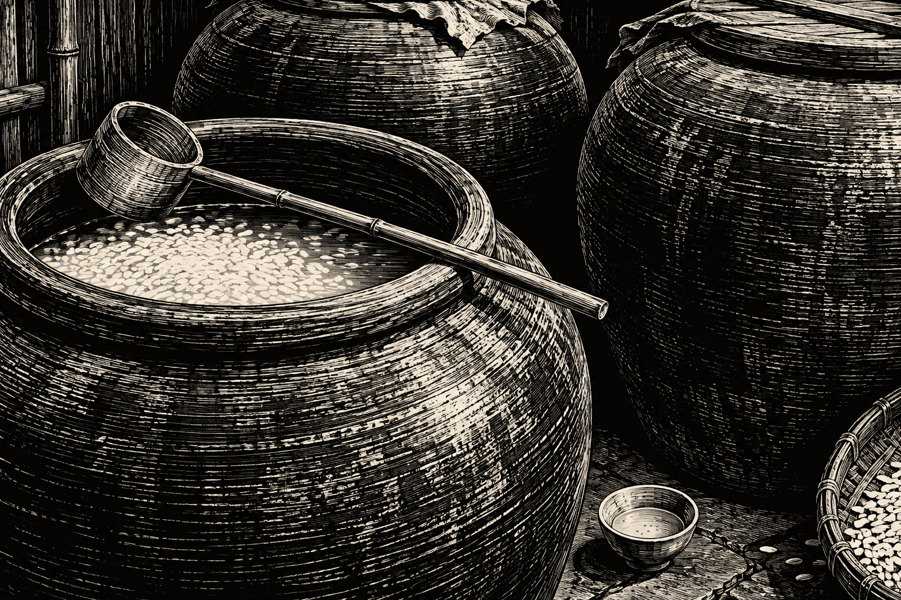
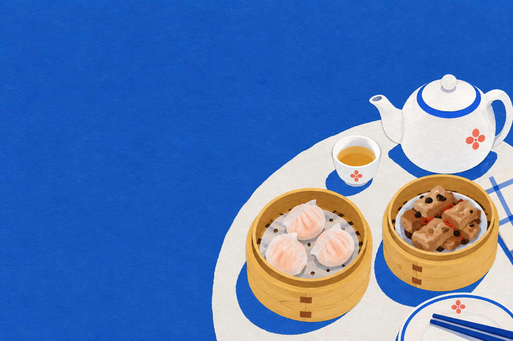
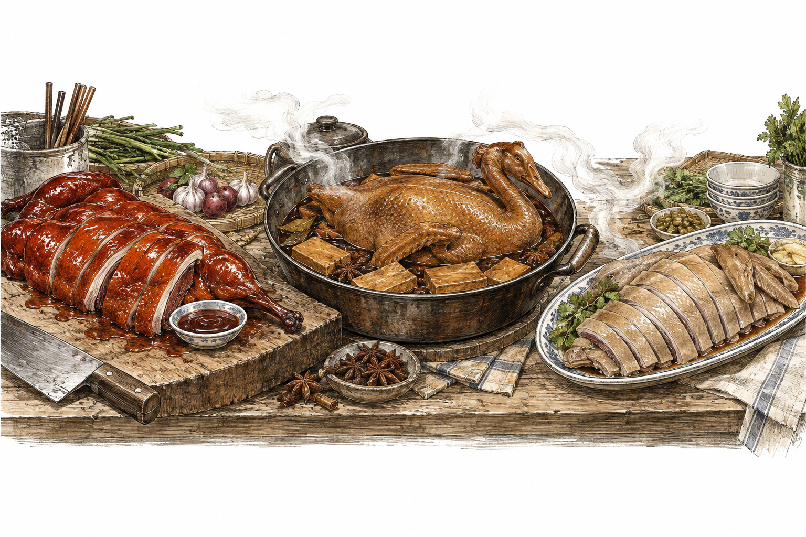
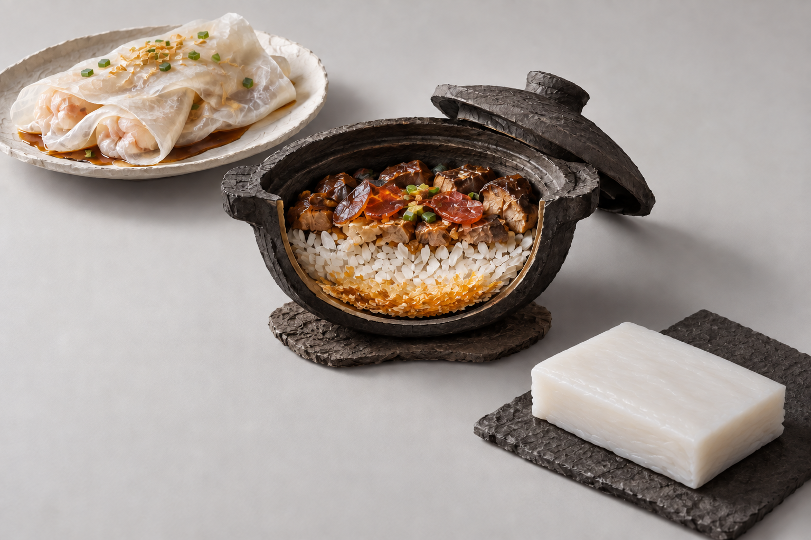
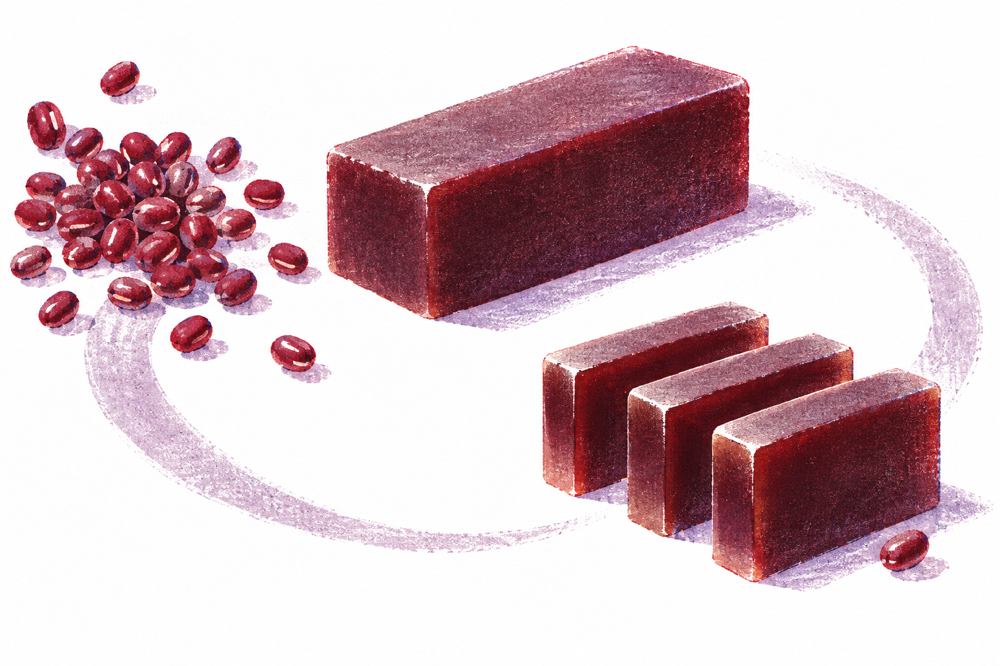
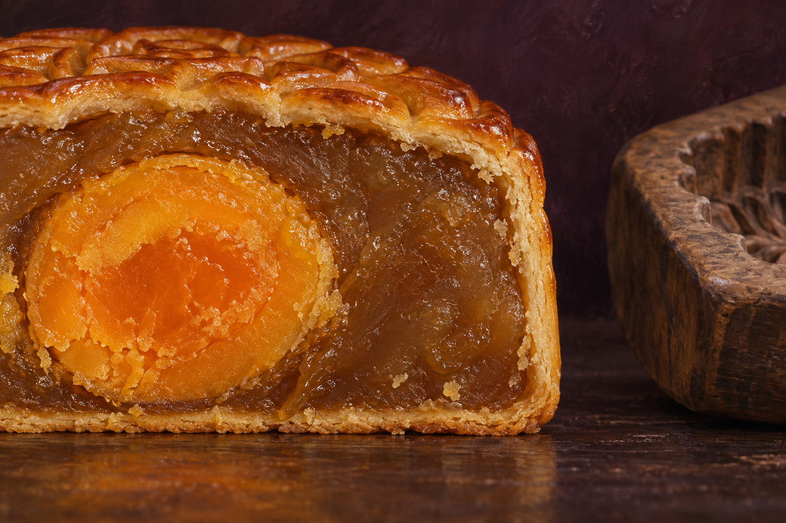

# 序

《吃吃喝喝》是商务印书馆出的书，收录了周作人谈饮食的文章。周作人是鲁迅的弟弟，兄弟俩后来有过矛盾。他自己很有名，名气却总是不及兄长。

<!-- more -->

# 饮饮食食——《吃吃喝喝》

去年我去了趟绍兴，在那里住了几天。周作人也是绍兴人，读他写故乡的酒和吃食，我觉得还能说上两句。饮食方面的书我也看过一些，从广州江太史和太史蛇羹的故事，到蒋勋讲生活美学、蔡澜讲吃吃喝喝，各有各的风格。真要论喜好，我可能还是更喜欢蔡澜。

## 酒

绍兴酒，当地人用浅而大的酒碗，温了酒再喝。作者笑谈，花雕酒也是黄酒，不过装酒的坛子雕了花，才有了这个名字。至于陈年好酒，则是可遇不可求。他父亲很能喝，自己却喝不了多少；因为患病，照医生的话喝了几年酒做药，可酒量也没见长。

客家人喜欢酿糯米酒，酿得好，满缸酒都是甜的；酿不好，满缸都是酸的。我家也试过自己酿，酿出来总是酸不溜秋，后来便不酿了。能缸缸都酿得甜，确实是一份手艺。

我们喝的糯米酒，和别处的酒酿、酒糟大差不差。到了梅县一带，有客家娘酒，颜色深，口味也更香醇。江浙的黄酒却又是另一种风味，更像酒，不像甜甜的饮料。不过糯米酒喝着甜，几碗下去照样容易上头。

白酒、糯米酒、朗姆酒、白兰地、威士忌，究竟谁好谁不好，很难排个高下。怎么评价？主要看心情。

我最常喝莫斯卡托，也喜欢托卡伊和偏甜的香槟。莫斯卡托价格实惠些，餐前餐后总喜欢喝一点。

我爱甜，也爱酒。

喜欢的，其实就是好酒。

## 点心与早茶

周作人谈南北点心，说北京人家的点心可以当常食，江浙一带的点心则是闲食，喝茶时吃上一口。他初到北京，买点心总不满意，嫌这座古城没做出让他喜欢的茶食；说起广东点心，又觉得山东大饼更实惠。

广东点心和他说的南北两种吃法又不太一样。我们喝早茶，也喝午茶、下午茶和夜茶，不分时间，也不一定要算作正餐。虾饺、凤爪、排骨，可以当一餐吃，也可以只是闲来喝茶，吃上一两样。

像我现在年纪大了，确实吃不了太多，去喝茶也多是一盅两件。喝一壶茶，吃点点心，要的就是这个感觉和味道，并不是为了吃饱。这样就已经有一种怡人的满足。

江浙富庶，自有它的文化底蕴。一个地方富裕起来，当地的饮食文化也会跟着出名。我想，如果没有改革开放后广东的发展，加上香港文化的影响，或许不会有那么多人了解早茶和粤菜。

## 各地的口味

一个地方有一个地方的饮食。我在绍兴住的几天，就不太喜欢当地的口味：甜的太甜，咸的又太咸，鲁迅故居门口买的蚕豆还硬得崩牙。所以江浙人吃不惯广东点心，我也能理解。

鹅肉也是各地各有吃法。周作人说，乡下有人嫌鹅肉粗，不把它当好东西；他自己却喜欢吃熏鹅、糟鹅、扣鹅。在广东，我觉得烧鹅比烧鸭更好吃：个大、油多，皮烧得红而脆，肉里还有汁水，蘸点酸梅酱，非常解腻。还有碌鹅，做起来也费功夫：整只鹅先煎上色，再加酱汁慢慢焖，中间还得反复翻动，让各面都受热、入味。做得好，肉不硬、不柴，连垫在下面的豆腐干都好吃。潮汕澄海还有卤狮头鹅，鹅头、翼掌也都入卤水，鹅肉虽然有时偏柴，但也香味诱人。有人看不上的鹅，在广东却有这么多吃法。

不过，有些吃食离开本地，做法和味道确实会变。就拿肠粉来说，在广东要的是口感丝滑，酱油略淡、微甜，带点鲜味。到了有些地方，端上来却是一块硬粉，口感和酱油都不对。这样的米粉让别人怎么能爱吃呢？煲仔饭也是：在广州，生米下锅，菜汁、米饭和饭焦的香味一起出来；在外地吃到的有些，饭是饭、菜是菜，完全把盖浇饭和煲仔饭混淆了。

烧鸭的差别更明显。我在大连吃到的像北京烤鸭，在贵州吃到的又介于北京和广东之间。广东烧鸭要皮有韧性、肉有汁水，不硬、不柴、不干。一位烧鸭店老板告诉我，两种做法连选的鸭子都不同：北京烤鸭看重厚皮烤出的脆，广东烧鸭要的是皮肉之间的鲜嫩，还有酱料烧出来的味道。

同样的东西，不同地方做出来完全不一样。哪怕在广东本地，也不是每家熟食斩料店都做得好。

所以现在遇到不爱吃的菜，我会觉得要么是这家馆子做得不地道，也有可能人家做得地道，只是我自己不喜欢。

正如我在广州吃贵州菜，觉得不若贵州正宗，但大体方向还算一致。在广州吃东北菜，我会更挑剔：锅包肉的口感好不好，酸甜酱味道对不对，搭不搭；小鸡炖蘑菇是否味精太重，鲜甜味出不来。

将心比心，广东人到了外地吃粤菜，也会格外挑剔。有些馆子恐怕做得不及格，但挑来挑去，只能说总比没有好。

没在粤地吃过地道粤菜的人，评价粤菜不甚好吃，是可以理解的；不过我们想解释，却又有口难辩。

## 羊羹

我夫人是大连人，羊羹是她小时候常吃的点心，而我却从未听过，甚是好奇。后来在深圳万象城偶遇了一把，便买了几份回家。可羊羹到底是什么、怎么来的，她也说不清楚。

没想到，读周作人的书，倒把这件事看明白了。按他的记述，近代国内的羊羹是从日本传来的，北京也开始仿制，连“羊羹”这个名字都沿用了。可再往前追，它又可能是中国的点心传到日本，几百年后换了个面貌，再传回中国。

羊羹到底是什么？他用中国话解释，就是“豆沙糕”。里面没有羊肉，用的是小豆和糖，做成块以后再切开来吃，所以他在《羊肝饼》里又说，叫“豆沙糖”才更明白。

没有羊，为什么叫羊羹？周作人提到，上田恭辅说它是模仿中国古代的羊肝饼做的。日本羊羹店另有一种传说，说是看见羊肉冻子才想到的，周作人觉得这个说法有些牵强。在《羊肝饼》里，他认为比较合理的解释是：这种豆沙点心因为颜色像羊肝，原先叫羊肝饼，传到日本后，名字讹成了羊羹。不过，名字究竟是怎么传讹的，他也说不知道。

他还说，日本的留学僧人从中国带回了这种食品，后来随着茶道流行，成了茶点，又传回中国，真是有趣。不过日本文化确实有这种特色，在一样东西上精益求精地做下去，吃上也是这样，连羊羹也有专门做它的店。

羊羹有纯豆沙的，也有加栗子、柿子的。周作人偏爱纯豆沙，觉得别的都是旁门。

## 月饼

小时候我以为全天下的月饼都一个样：莲蓉馅、豆沙馅，最好还得有个咸蛋黄。后来离开广东求学、工作，才知道，每到中秋，自己想念的其实是广式月饼。别处的月饼不是不能吃，只是我最想吃的，还是那一口豆沙和莲蓉。

《燕食记》里大概也讲过，广式月饼不好做。饼皮用糖浆、油和面粉调成，要薄而匀，又得包得住馅。做莲蓉、豆沙，要先把莲子或红豆煮软、磨细，再加糖和油炒制，炒得太湿，包进去容易塌；炒得太干，吃起来又硬。烘烤也要分次，先把饼烤定形，再刷蛋液上色，既要烤出金黄的色泽，又要保住花纹，不能开裂、塌陷。

做得好的月饼，饼皮薄而柔软，馅细腻而油润，切开以后皮馅贴合。吃到嘴里，饼皮的香气、莲蓉的甜味和蛋黄的咸香要糅合在一起，相得益彰。

小时候我爱吃豆沙月饼，因为便宜。莲蓉月饼里，常见的是红莲蓉蛋黄月，最贵的却是白莲蓉蛋黄月。然而，我到现在都嫌白莲蓉太腻。今年我夫人说，她看到最贵的反倒是红莲蓉蛋黄了。我感叹世道变了：当年白莲蓉贵，也许贵在工艺，不一定是因为更好吃。

我向来独爱红莲蛋黄，现在它倒成了最贵的那一种。我想，怕是真正爱吃的人，最后都会这么选吧。

在我看来，甜腻的月饼必须就着一口新鲜浓郁的绿茶，最好是毛尖。一个甜腻，一个苦涩，交融在口里，相得益彰。这种感觉有点像牛扒吃腻了，来一杯红酒，苦涩的单宁味遇到了丰厚的牛油脂，顿时豁然开朗；又如干白的味道配上生蚝、鲜虾等海鲜的味道，却又是一种丰饶的风味。

月饼亦是如此。

## 茶

周作人说，自己吃茶，从量到质都够不上什么品位。他从小喝本地出产的茶，叫作“本山”，叶片搓成一团，不像龙井那样平直，价钱也便宜。后来也喝朋友送来的各地茶叶，尝过不同的味道，却仍说自己不会喝茶，只是喜欢“玩茶”，喜欢拿这个题目说说写写。

而到如今，我也到了四十，算是步入中年，在不同的地方生活过，了解了一些风土。就说喝茶这件事，一个地方有一个地方的口味，本地人爱喝本地茶。对于别处的好茶，大概也有些附庸风雅，跟着说上一两句好话，但真正喝惯的，确实是自己从小喝到大的茶。

这个东西说破了，并不是说别的地方茶不好，而是生活习惯带来的品味和口味很难改变。我生于粤北，喝惯了粤北的红茶和毛尖。往后无论怎么再喝所谓价格更高、品质更好的茶，亦不觉得比儿时家里喝的更顺口。

之前读冈仓天心，他谈日本茶道，把茶与道教、禅联系起来，讲的是近乎宗教的仪式。在我看来，茶在中国是平民化的饮食，并不需要宗教式的仪式。喝茶的方式本来也一直在变，从唐代的煮茶、宋代的点茶，到明代以后盛行的散茶冲泡，并不是从来都像今天这样。

到了西方，茶里又加上了奶和糖，也是另一种风味。对我来说，其实我也是喜欢的。

我喜欢锡兰红茶，可能就是因为它和我熟悉的英红九号有些相近，都有那种浓醇的红茶味。加上奶，有港式的奶茶、印度的拉茶，茶味很浓，奶味也很浓，中间用糖来做平衡，我也喜欢，然不见得其他人会喜欢。

# 结语

周作人说，人除了日用必需，还得有一点无用的游戏和享乐，生活才有意思。

看夕阳、看花、听雨、闻香，喝不求解渴的酒，吃不求饱的点心，都是生活上必要的。

虽然是些无用的装点，却也是越精越好。

