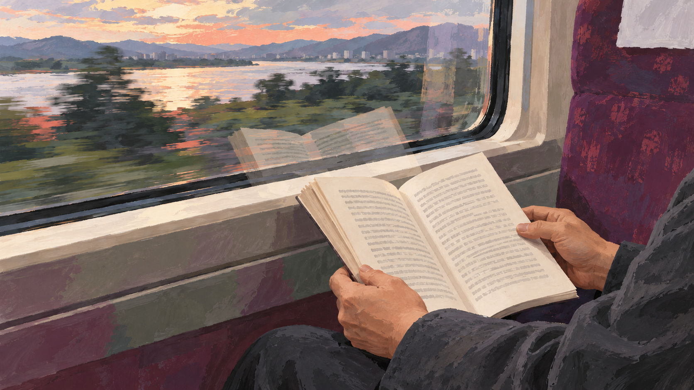
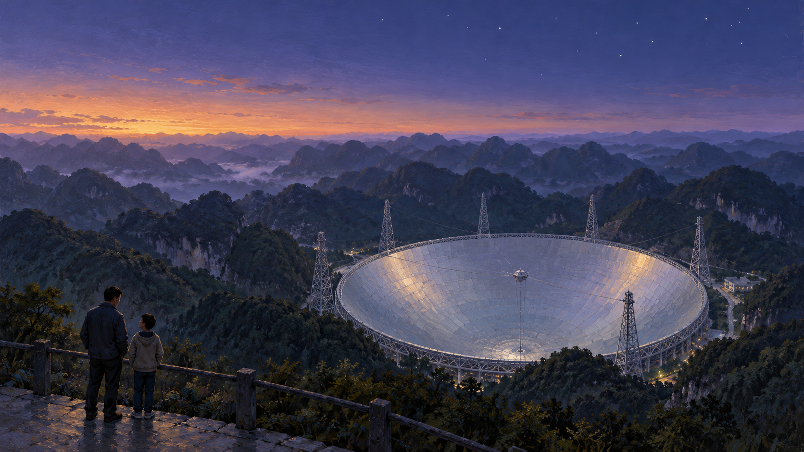
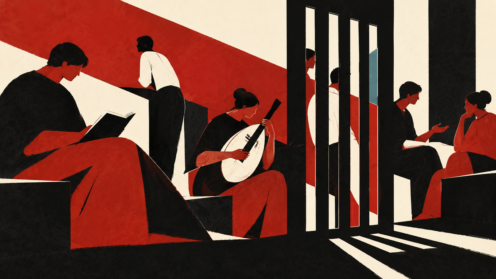
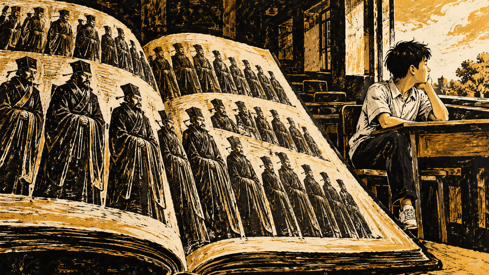
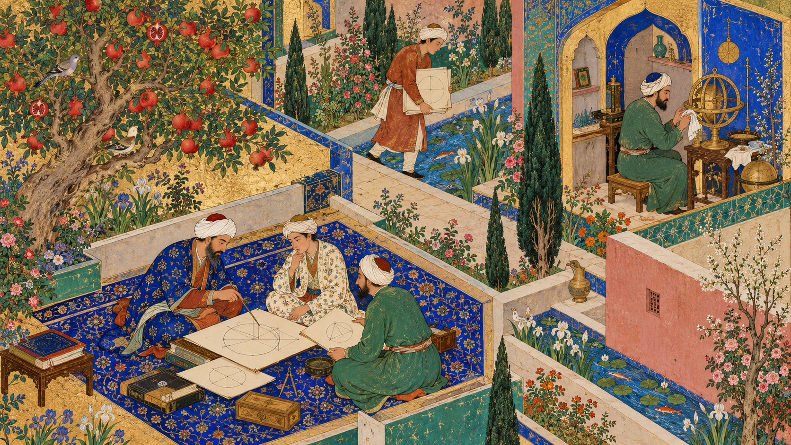
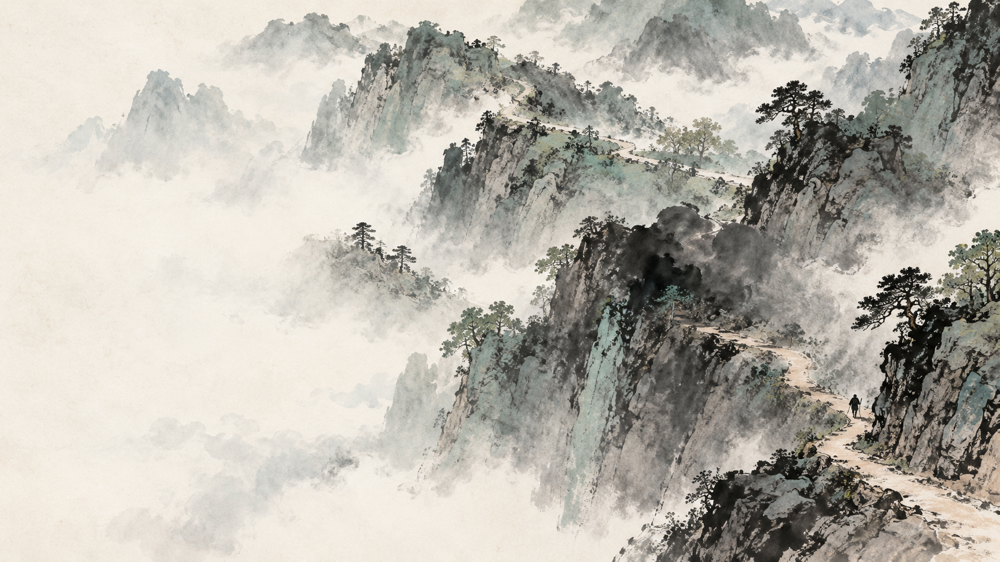
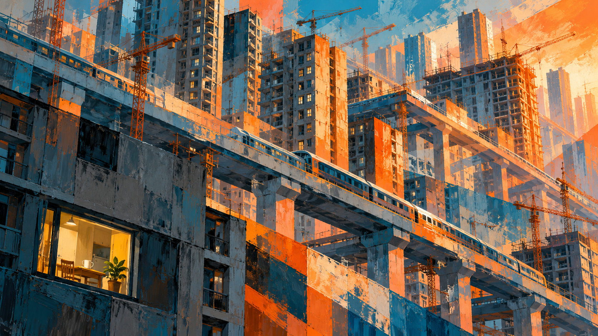
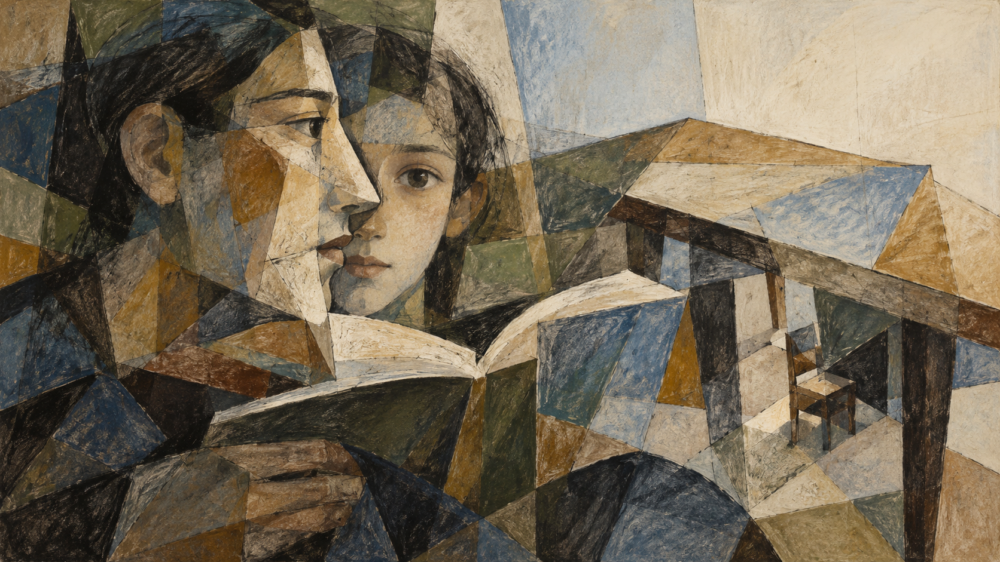
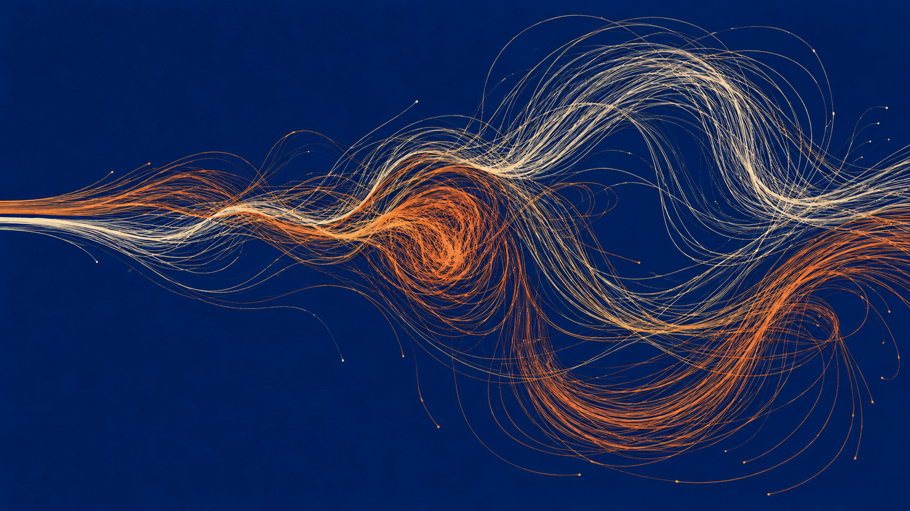
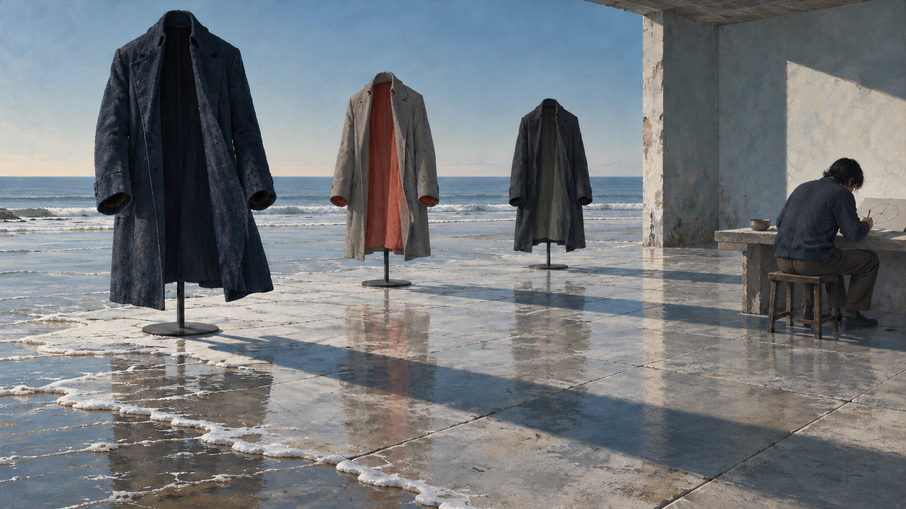

# 序

一个多月没写读书笔记了。

原因有很多：一是放假要带孩子出去走走，于是趁着假期花了几天去南京看了一看，领略这个让唐代文人一再咏叹“六朝”的地方；前几天也因为工作的缘故，去了一趟成都。

蒋勋的这本《生活十讲》，便是在我来回的旅途上读完的。

其实还是像以前一样，我不太舍得读蒋勋先生的书，总感觉读一本就少一本。看着书架上还有没读过的，我总会觉得，在人生的某些低谷、在情绪陷入消沉或迷茫的时刻，自己总归还有一个救星、一份拯救。蒋勋先生的书对我来说，一直就有这样的作用。

不过在准备出差的时候，我在书架上随手翻了翻，不经意间又抽出了这本《生活十讲》。那就顺应这份机缘吧，于是在来回的路上，一口气把它读完了。

<!-- more -->

# 回到人的本分——《生活十讲》

在书的前言里，蒋勋说，这本书其实是他在 20 世纪 90 年代主持电台节目时所讲的内容。这个广播节目叫《文化广场》，每星期一次，大约一小时，谈一些与文化有关的现象。

因为当时他在大学美术系任教，觉得广义的文化不能局限在狭义的艺术范畴；相反，社会里更多的人和生活现象，往往比艺术更能反映出文化的本质。

节目一做就是十年。十年的录音在多年以后，由联合文学的朋友整理出来，便有了这本《生活十讲》。

所以这本书记录的，不仅是蒋勋在 20 世纪 90 年代的一些思考与看法，也真实记录了当时台湾在经济高速发展中，人、文化与经济之间所遇到的困惑。为什么今天读来大家会有共鸣？或许正是这种错位的时间和相似的状态，让人有一种似曾相识的感觉吧。

其实这本书每一讲开头的那句话，都能引起我很深的认同感。

## 分数之外：新价值

第一讲“新价值”的卷首语写道：“一个唯利是图的社会，每一个人都在物化自己与他人的过程中成为受害者。”

蒋勋在书里讲到，有些人的专业知识分数很高，但在道德和情感的处理上却是零分。

蒋勋问：“这样的人是坏或残酷吗？”

他不觉得。他认为那种人根本没有选择，平常没有这样的准备，缺乏对人性的了解，到了无所措手的时候，只会做出让人惊愕的事情。

关于文学，蒋勋说自己在十三四岁、读初中的时候就很苦闷，因为身体的变化、青春期，以及周围的人和事，让他感觉很难过，于是他在文学中寻找人生的回答。

同时，他的同伴一头钻进了考试里。今天回头去看，他觉得那些同伴都不快乐。虽然他们考上了最好的高中、最好的大学，也留学回来了，但对于情感、婚姻等各方面的问题，他们没有办法回答。因为对于人性和真正的自我，他们从来没有机会去触碰——考试不会考。

知识不完全等于智慧，也没有办法转换成智慧。

这件事到了今天，对我们来说变得更难、更沉重。因为即便不学习，AI 也能为你提供很多知识，可知识和智慧又该如何评价？

这或许是大部分人都没有清晰认知的。蒋勋说，社会一直在造就这样一批好学生，而且他们本身也洋洋得意，因为一直以来都是优等生。他们考到这样的成绩，读这么好的专业，从来没有怀疑过自己会有问题。

但是蒋勋认为，明星学校没有任何保障，知识分数越高，自己反而要越小心，因为要面对的生活难题都不在这些分数里头。

以前的知识分子，追求的是“士不可以不弘毅，任重而道远”。学校不能只训练考试机器，孩子不能被这样牺牲。最好的音乐、最好的电影、最好的文学，是自然而然熏陶人的，而这些东西都是不能考试的。

### 读天文有什么用

社会的整体价值观，慢慢慢慢的，不知道怎么的就变成了“唯利是图”。年轻人的价值观里也有了一个“利”字。

我的小孩刚刚上初中。有一次我跟他分享我小时候的经历，说当年我有一个做科学家的梦想，锚定的是天文学，想去南京大学读天文系。无奈自己的成绩不够好，没有达到南京大学的录取分数线，于是变成了现在的样子。

我小孩一脸茫然地说：“幸亏你没读天文，不然你去哪里工作呢？读这个有什么用呢？”

我惊愕了，因为我从来没有想象过，我的孩子会问我这样一个问题。

我说：“我读了天文，我可以继续研究理论啊，可以去紫金山天文台工作啊，也许我们去贵州看过的天眼，就成为了我工作的一部分呢。”

探索未知，寻找人类新的疆界，这种所谓崇高的理想，在现在可能变成了一个笑话，或许在我的同龄人眼里也是一个笑话，而我总是这个笑话的主人公而不自知。

人到中年，我可以很负责任地说，我并不是个考试型的选手，但在知识的领域，我一定是个长跑型的选手。虽然有时我很难一眼就锚定哪些是考点、哪些一定要考，但我会不断思考、不断深入，在别人觉得稀松平常的地方，找到一些需要解决的人和事。

我相信，如果这么来看，我一直以来的成绩不好，是因为我不擅长考试。高考，并不是一个只能让会考试的考生胜出的机制。长期默默、不断求知和探索的经历，让我最终还是能够在高考中脱颖而出。

这毕竟是一个高考结束二十多年的人，在回望过往时才可以这么说的。我从来不敢把这样一种体验和生活交到我的孩子手里，于是就有了这样的发问和对话。

我的所思所想都很零散，但无不和蒋勋先生谈到的那么一致、那么契合，以至于他的每一句话、每一个观点，我仿佛都有一种深深的认同感。

总有一些往事和过去的经历，能够印证先生所言。

### 单向度的评价

蒋勋先生说，读古文、读古书，尤其是中国的古文和古书，在当下多少还是有点用的。因为任何知识都要回到人的本分，知识回不到人的本分，那个知识一定会出问题。

蒋勋先生又说，人有时候很奇怪，会依靠外在的东西让自己有信心，人类文明也是这样。大家可以通过不同的方式使自己有信心，前提是要有一个成熟丰富的文化作为支持。

或许一个人在某一方面高大，另一方面就有短板，每个人都有自己不同的社会价值。

“唯利是图”，就是价值的单一化，经此一役，人就被完整地物化了。用统一的标准去衡量，很多问题就会油然而生。

单向度的生活和单向度的评价，人容易没有出路。只有一个维度的评价，而这个维度或许刚好就是他不擅长的，那便会很痛苦。他并不知道自己所拥有的东西有什么价值，也就不可能产生一种富足的感觉。

看到别人有而自己没有的东西，心生出的或许不仅仅是羡慕和敬佩，还会产生抢夺、掠杀之心。没有办法安分地做自己，也就难以充分地活在快乐和满足中。

## 我可不可以不死：新官学

第二讲的开头，蒋勋先生说：“要让下一代有气节，也要有性情；有理性，也要有幻想。一个多元的人才是完满和健全的。”

蒋先生说，他成长过程中非常喜欢语文，从小到大语文成绩都是数一数二。因为数学成绩不好，所以优异的语文成绩给了他很大的成就感。

读文天祥的《正气歌》、方苞的《左忠毅公逸事》，会让人产生气节，但也会让人产生恐惧。因为这些铁骨铮铮的文人会让人觉得，死是一件很有使命感的事情；如果不死，就难以成为一个伟大崇高的人。

他的学生读完之后问他：“我可不可以不死？”

他说：“当然可以。”

学生又问了一句：“那官做到多大才应该死呢？”

这看起来是一个笑话，但不得不说，确实会有人是这么想的。

好的文化范本需要正面和反面的思考，有了思考，才是启蒙。试想，司马迁因李陵之祸遭受宫刑之后，还能忍辱负重，继承父亲写史书的遗愿，完成《史记》，留给后人。

而到了宋元之后，在这些文章里，“死”就变成了义无反顾的选择。

所谓官学，蒋勋先生想说的其实就是教科书。教科书里所选的内容，学生需要怎样理解才更科学、更合理，一直都是个颇具挑战的问题。蒋勋说，相比起儒学，他更喜欢有启蒙性的老庄道家学说。

因为老庄的定位在天，而天比较接近神话。如果只相信科学，人就会被框死；还要有一个混沌的、更大的理想，有不可测的东西，人才会变得更宏大、更宽广。

### 神话与幻想

说到神话，蒋勋还有一个观点让我印象很深：幻想是跟科学有关的，没有幻想就没有科学。

神话的消失，对中国发展科学造成的影响其实蛮大。因为当我们满足于人的世界，怎么会愿意尝试飞起来呢？

所以，如何做到有气节、有性情、有理性、有幻想？多元的价值观怎样才能融合？这或许才是当下对于自己、对于小孩最需要做到的。

### 什么是经典

蒋勋先生谈到什么是经典：经典之所以是经典，就是要不断接受挑战，不接受挑战就不配叫经典，接受了挑战还能流传下来的，那就是经典中的经典。

像《诗经》《楚辞》，在蒙古人入主中原之后，依然被读、被传了下来。虽然里面描述的内容跟他们的生活无关，但他们还是从中得到了美的意象。

## 难是幸福的开始：新伦理

第三讲的卷首语是：难，绝对是生命中幸福的开始，而容易，绝不应该是庆幸的事情。

这一讲从法律开始。

我们都认为法律是冷冰冰的、不讲人情的，但绝不敢说法律是没有文化的，因为没有人文关怀的法律是很可怕的。

蒋勋不相信报复性的法律能够制止犯罪。只求报复、没有对人的关怀，这就是没有文化的法律。真正好的文化规范是内省的，不是向外指责。人没有内省的能力，忙着指责别人，迟早会用不同的方式杀人，甚至法律看起来也像是在杀人。

而内省的能力需要教育，不是天生的。教育没有引发出人的思考和内省能力，最后却要求他自省，这就是杀人凶手。

### 另一个伊朗

蒋勋说他自己对伊朗一直不了解，直到看了伊朗导演阿巴斯的电影，才忽然觉得伊斯兰文化也有非常伟大、感人的东西，而不仅仅是我们平常在新闻里看到的那些负面形象。

我最近也有同样的想法，尤其是看完《丝绸之路》之后，才知道公元**8 到 13 世纪**，在伊斯兰的黄金时代里，今天伊朗所在的波斯地区曾经有那么灿烂和伟大的文化：当欧洲还处在中世纪的时候，是这里的学者保存、翻译并发展了古希腊的学问，把人类的文明推向新的高度，后来又反哺了欧洲。

这也是我以前不怎么知道的。虽然我还没看过阿巴斯的电影，但我非常认同蒋勋先生在这一讲里说的话。

### 容易得来的东西

如果我们从花很长时间期待、很困难才得到一样东西，变成很快速、很容易就能获得，而且选择更多，就会导致后来的不珍惜。这个现象转换到伦理和人际关系上，就变成了新的问题。

当然，现在有了 AI，很多数学、物理问题的解答，还有文章，不用自己花很长时间训练和学习，也能很快拿到。这样下去，孩子们和社会会变成什么样？这种对社会文明的破坏力也是极大的。

所以，如果法律和道德没有把人的权利与义务界分清楚，又没有群体制衡，就会像动物一样大家一起抢，变成丛林文化。

光靠法是不够的，需要文化、道德、宗教来辅助。若法不公正，其他辅助力量就会浑水摸鱼，甚至反过来伤害法。

## 螺旋形的山：新信仰

第四讲谈信仰。

蒋勋先生说：“信仰本身是一个过程，它并不在于终结点。”也就是说，你不是真的要崇拜一个人或渴望一个东西，而是心里要保持崇拜感。这个崇拜感可以是宇宙，可以是潮汐，可以是因果。但这种信仰和崇拜需要思考。

商业用金钱堆砌出来的偶像，会让人没有思考；被造就的偶像，他的照片、他的商品，让粉丝们又哭又叫，又爱又笑。

正如前面说的，知识并不能等同于智慧，知识也没有办法解决信仰的问题。信仰其实都会伴随着内省。

但是如果信仰被孤立出来，那它就很危险。譬如只有政治信仰、只有财富信仰、只有权力信仰，甚至只有单一的美的信仰，都是不健康的。信仰是要被平衡的，被平衡了的信仰才是多元的。

信仰没有速成之道，它是一种长时间与困惑对话的关系，像是在一座螺旋形的山上盘旋，每次盘旋好像升高了一点点，又好像在原地打转。

信仰追寻的旅程是不会停止的。

文化与现实生活是结合在一起的，要落实在生活中。文化如果从生活中隔离出去，这个文化就是一种假象。

读书求索也是，仅仅是为了那个分数，这明明就是一种造假，也是一种假象。

真正的信仰跟真正的经典是一样的，它不会因为怀疑和质问就瓦解。相反，正因为经历了怀疑与质问，信仰才会变得更牢固。最好的信仰，一定是能经受住所有人怀疑的。

## 踩刹车的人：谈物化

第五讲的卷首语是：没有绝对精神上的快乐，也没有绝对物质上的快乐。走向极端的任何一边，都可能引导出一种不健康的生活。

这一讲更重要的，是讲如何制衡人的物化。

蒋勋说到台湾建筑系和法国建筑系学生的差别：同样是欲望，法国建筑系的学生要的是一种名誉的、清高的渴望，而我们的学生想的是如何在毕业以前把钱赚饱。

建筑系的学生如此，信息系的学生也是：他应该思考如何设计出一种程序，引导一场计算机革命，而不是赶快开发一种软件拿到商场里卖钱，或是盘算毕业后进哪一家大公司当工程师。

如果思维被困在消费形态中，整个大学体制就会垮掉。

买一个房子，如果不是因为它让你感受到快乐、给你提供安全感，或带来视觉上的享乐、精神上的满足，而是因为附近要修地铁、房价要涨，你觉得房子值得投资、前途看好，这就是一种物化。

房屋的价值并不是由你来主控的，你被物质所引导。

### 知识分子的刹车

蒋勋说，中国人特别压抑商人，是出于政治上的考虑，防范官商勾结。中国人很早就意识到这两种人走到一起的严重性。

蒋勋还说到，社会的物化发生在不知不觉的过程中。他在法国读书的时候，亲眼看到萨特和阿拉伯工人站在一起游行。那些少数坚守自己岗位、抗拒物化的人，保住了自己作为一个知识分子的坚持，跟社会底层的工人站在一起。

整个欧洲在工业革命之后，其实是靠这一群有良心、有觉醒的知识分子在踩刹车。

一个成熟的欧洲社会，就是右派的资本主义要往前冲，左派的社会主义在踩刹车，两股力量相互制衡。知识分子要尽一份力，就不能那么入世，入世就有可能被卷入绞肉机。

保持一点点出世的思想，保持一种冷静，才能看得清楚。这种客观性、这种独立思考，是不能站在任何一个利益群体中为其做解说的。

## 疏离与化身：文学

下一讲的卷首语是：人生是一座桥梁，重要的不是目的和结局，而是过程。这就是为什么我们需要文学。

文学是一种文化的疏离。当你在镜子里看见自己的时候，若能疏离，就能产生文学。

通常我们无法疏离，很容易投射，很容易陶醉，很容易一厢情愿，就会看到很多假象。很多经文讲出来的，其实就是我们一直都在观看假象，因为我们对假象已经习以为常。

在很多宗教里头，成为信徒，反而成了欣赏文学的障碍。如果不是透过经典的语言来看文明的伟大，就不会发现经典原来就是文学。

文学的终极关怀，是人生真相和假象反复的呈现。

文学和哲学不一样：哲学是寻找真相，可以一路残酷下去；但文学不忍。它不忍时就会“假作真”，它残酷时就会“真亦假”。

每个人身上都会有一些固执坚持的假象。当假象越来越美好、越来越大的时候，就没有办法面对真相了。

如果没有文学，我们总是会站在自己的角度，用喜欢或不喜欢去评判一个人、一件事情。有了文学之后，我们会化身，用别人的角度去重新思量。

## 十年一问：我的混沌

这些话是蒋勋三十年前在电台里讲的，十几年前就整理成书出版了。可到了 AI 迅猛崛起的今天，很多原本是文化人的担忧或倡导，瞬间变成了一种预言应验的感觉。我们从来没有像今天这样，应该对人、对物化、对意义这么执着。

正如前面几讲的内容，无论是难和易、文化，还是有用、物化，都是现在我们没有办法回避的。

这一个月尤其如此：一方面看到 AI 不断发展，能做的东西越来越多；另一方面，也看到了深受其害、被逆向、被攻击的受害者。

再回到我自己，当听到孩子说“读天文、研究科学有什么用”的时候，我猛然、幡然地感觉到：大家其实跟之前一样，打着科学的旗号，并没有认真地研究科学。

所以我想，在这个迅猛发展又很奇怪的今天，作为一个有计算机背景的人，我能做什么，或者说，我应该怎么做？

有时候我会想起柏拉图的洞穴寓言：被锁在洞穴里的囚徒，一辈子只能看着火光投在洞壁上的影子，把影子当成真实；其中一人挣脱枷锁走出洞穴，看到了真实的世界，可等他回去告诉洞穴里的人，却没有人相信他。

或许针对 AI，也有许多类似的故事。

至于我自己，我还是打算继续研究混沌。

我一直以来都很喜欢这个东西，然而一些问题上的卡顿，让我思考了十余年。最近又看到了那本《混沌》，所以我现在一直在看。读着读着才发现，我所遇到的所有基础性问题，这位研究数学的老先生其实早已写得很清楚了。

我也翻看了上海交通大学出版社出的中文译本，始终不如人意。而当我使用 AI 去翻译的时候，那种信达雅、很美妙很优美的描述，深深打动了我。

当我继续跟 AI 不厌其烦地去了解动力系统的细节：李雅普诺夫指数为什么要这么设置，相空间最想表达什么，为什么要引入相空间……在与 AI 的多次交互中，我突然感受到了那种快乐。

一个思考了很久的问题，终于想通了。这就是所谓的难和易吧：如果一个东西很简单就能得到，那其实不是生活本身；一个东西很珍贵、很难，甚至求了十多年才获得答案，你会觉得非常非常开心。

有些话题我本该留到下一本书的读书笔记再讲，但还是忍不住在蒋勋这本书的笔记里先提了出来。

# 结语

更重要的是，这个时代真的需要我们有真实的思考，需要我们真实地提出问题，并有去尝试解答问题的能力。

福柯说过，知识本身就是一种权力。曾经那些被高校、被教授、被教职所垄断的知识权力，突然有一天被释放了出来。

当连数学难题都开始靠“大力出奇迹”来解决的时候，找到问题、认识问题、解决问题，或许才是我们学习的意义。

太多人只是假装在做这些事情。AI 的降临，就有点像所谓的大潮退去，就能看到众多裸泳的人。
